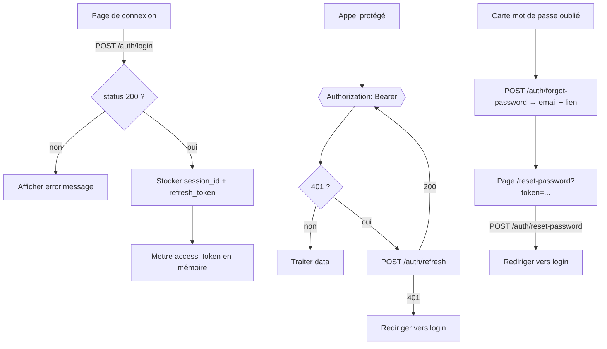

# Guide d'intégration Frontend — Auth (IDS API)

> À lire en premier : URL de base, enveloppe de réponse, codes d'erreur.
> Exemples concrets pour chaque endpoint — copier/coller prêts à l'emploi.

## 1. Base URL

```
http://localhost:5000/api/v1
```

## 2. Enveloppe de réponse (uniforme)

Toute réponse suit ce format — `data` en succès, `error` en échec, jamais les deux en même temps :

```json
// ✅ Succès
{
  "data": { "user_id": "..." },
  "message": "Opération réussie",
  "status": 200,
  "error": null,
  "meta": null,           // rempli seulement pour les listes paginées { page, limit, total }
  "signature": "IDS"
}
```

```json
// ❌ Erreur
{
  "data": null,
  "message": "Identifiants invalides",
  "status": 401,
  "error": { "code": "UNAUTHORIZED" },
  "signature": "IDS"
}
```

**Convention frontend** : vérifier `status`; lire `data` si succès, `error.code` + `message` pour afficher l'erreur à l'utilisateur.

| Regex de codes d'erreur fréquents : | |
|---|---|
| `BAD_REQUEST` | champs invalide (afficher `details` le cas échéant) |
| `UNAUTHORIZED` | rediriger vers login |
| `CONFLICT` | doublon (email ou nom déjà utilisé) |
| `TOO_MANY_ATTEMPTS` | throttle login — afficher message patienter |
| `INVALID_RESET_TOKEN` | lien reset expiré |

## 3. Récupérer le token depuis le header

Toutes les routes protégées attendent le header :

```
Authorization: Bearer <access_token>
```

| Champ | Source | Durée |
|---|---|---|
| `access_token` | réponse login / register / refresh | 15 minutes |
| `refresh_token` | réponse login | 7 jours |
| `session_id` | réponse login | — (à renvoyer pour logout / refresh) |

> Le `access_token` expire en 15 min. Sur réponse 401 depuis les routes protégées, appeler `POST /auth/refresh` puis rejouer la requête initiale.

## 4. Endpoints

### 4.1 POST `/auth/register` (public)

Body :

```json
{ "user_name": "Jean Dupont", "user_mail": "jean.dupont@example.com", "user_password": "MotDePasse123!", "user_phone": "+2250700000000" }
```

Réponse `201` :

```json
{ "data": { "user": { ...sans password }, "access_token": "eyJ..." }, "message": "Utilisateur créé avec succès", "status": 201, "error": null, "signature": "IDS" }
```

Erreurs attendues : `BAD_REQUEST` (validation), `CONFLICT` (doublon au 409).

### 4.2 POST `/auth/login` (public)

Body :

```json
{ "user_mail": "jean.dupont@example.com", "user_password": "MotDePasse123!" }
```

Réponse `200` :

```json
{ "data": { "user": { ... }, "session_id": "<uuid>", "access_token": "...", "refresh_token": "..." }, "message": "Connexion réussie", "status": 200, "error": null, "signature": "IDS" }
```

> Après login, stocker `session_id` + `refresh_token` (cookie httpOnly ou localStorage selon la politique du front) pour la rotation et la déconnexion.

### 4.3 POST `/auth/refresh` (public)

Body :

```json
{ "session_id": "<uuid>", "refresh_token": "<refresh_token>" }
```

Réponse `200` : `{ "data": { "access_token": "..." } }` — nouveau access token uniquement.

### 4.4 GET `/auth/session` (auth)

Réponse `200` : liste des IDs de sessions actives de l'utilisateur.

### 4.5 POST `/auth/logout` (auth)

Body : `{ "session_id": "<uuid>" }` → `{ "data": null, "message": "Déconnexion réussie" }`

### 4.6 POST `/auth/logout-session` (auth)

Body : `{ "session_id": "<uuid>" }` → `{ "data": { "session_id": "...", "revoked": true } }`

### 4.7 POST `/auth/forgot-password` (public)

Body :

```json
{ "user_mail": "jean.dupont@example.com" }
```

Réponse `200` — **toujours la même réponse** (silence pour ne pas révéler l'existence du compte) : l'email est envoyé côté API avec un lien `APP_URL/reset-password?token=<token>` valable 15 min.

### 4.8 POST `/auth/reset-password` (public)

Body :

```json
{ "token": "<token reçu par email>", "new_password": "NouveauMotDePasse123!" }
```

Erreurs : `BAD_REQUEST`, `INVALID_RESET_TOKEN` (400 — token expiré ou déjà consommé).

### 4.9 GET `/auth/users` (auth, rôle `admin` ou `superadmin`)

Query params :

| Param | Type | Défaut | Description |
|---|---|---|---|
| `page` | int ≥ 1 | 1 | page courante |
| `limit` | int 1–100 | 20 | taille de page |
| `search` | string | — | ILIKE sur `user_name`, `user_mail`, `user_phone` |
| `sort_by` | enum | `created_at` | `user_name`, `user_mail`, `user_phone`, `role`, `created_at` |
| `sort_order` | enum | `DESC` | `ASC` / `DESC` |

Réponse `200` (enveloppe avec `meta` rempli) :

```json
{
  "data": [
    { "user_id": "<uuid>", "user_name": "Super Admin 1", "role": "superadmin" }
  ],
  "message": "Liste des utilisateurs",
  "status": 200,
  "meta": { "page": 1, "limit": 20, "total": 6 },
  "error": null,
  "signature": "IDS"
}
```

Erreurs : `401` (non authentifié), `403` (rôle requis : admin ou superadmin).

### 4.10 GET `/auth/profile` (auth)

Réponse : utilisateur courant (jamais de `user_password`)

```json
{ "data": { "user_id": "<uuid>", "user_name": "Jean Dupont", "user_mail": "...", "role": "caisier" }, ... }
```

### 4.11 PATCH `/auth/profile` (auth)

Body : champs optionnels `{ user_name?, user_mail?, user_password?, user_phone? }` → `data` : utilisateur mis à jour.

### 4.12 DELETE `/auth/profile` (auth)

Réponse : `{ "data": null, "message": "Compte supprimé avec succès" }`.

## 5. Rôles

Rôles possibles côté API : `superadmin`, `admin`, `caisier` — `caisier` est le rôle par défaut à l'inscription.

| Rôle | Accès |
|---|---|
| `superadmin` | tout, y compris `GET /auth/users` |
| `admin` | gestion, y compris `GET /auth/users` |
| `caisier` | profil / session uniquement |

Les endpoints protégés par rôle renvoient `403 Forbidden` avec `code: FORBIDDEN`. Prévoir côté front une UI par rôle.

> Seeder disponible : `npm run seed` crée 2 comptes par rôle (`superadmin1/2`, `admin1/2`, `caissier1/2` @ids.local, mot de passe via `SEED_PASSWORD`, défaut `ChangerMo123!`).

## 6. Flux typiques



## 7. Rappels sécurité (depuis l'API)

- Helmet actif (CSP, HSTS, X-Frame-Options…)
- Validation stricte des entrées — le formulaire côté front doit refléter les DTOs (`user_mail` email valide, `user_password` ≥ 8 chars avec casse variée, chiffre, spécial)
- Mot de passe jamais renvoyé par l'API
- Throttle : 5 tentatives de login / 15 min / email

## 8. Swagger (contrat complet à jour)

```
http://localhost:5000/docs
```