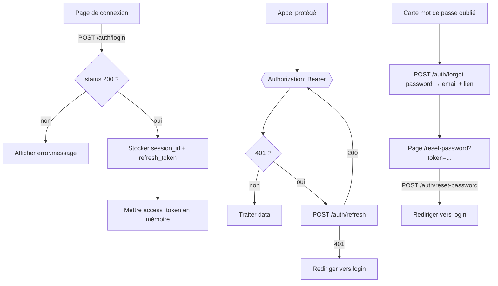

# Guide d'intégration Frontend — Auth (IDS API)

> Swagger tags : `Authentification Generale`, `Authentification Admin`, `Authentification caissier` (contrôleur `AuthController`, préfixe `/auth`).
> Exemples concrets pour chaque endpoint — copier/coller prêts à l'emploi.

## 1. Base URL

```
http://localhost:5000/api/v1
```

## 2. Enveloppe de réponse (uniforme)

Toute réponse suit ce format — `data` en succès, `error` en échec, jamais les deux en même temps :

```json
// ✅ Succès
{
  "data": { "user_id": "..." },
  "message": "Opération réussie",
  "status": 200,
  "error": null,
  "meta": null,           // rempli seulement pour les listes paginées { page, limit, total }
  "signature": "IDS"
}
```

```json
// ❌ Erreur
{
  "data": null,
  "message": "Identifiants invalides",
  "status": 401,
  "error": { "code": "UNAUTHORIZED" },
  "signature": "IDS"
}
```

**Convention frontend** : vérifier `status`; lire `data` si succès, `error.code` + `message` pour afficher l'erreur à l'utilisateur.

| Regex de codes d'erreur fréquents : | |
|---|---|
| `BAD_REQUEST` | champs invalide (afficher `details` le cas échéant) |
| `UNAUTHORIZED` | rediriger vers login |
| `CONFLICT` | doublon (email ou nom déjà utilisé) |
| `TOO_MANY_ATTEMPTS` | throttle login — afficher message patienter |
| `INVALID_RESET_TOKEN` | lien reset expiré |

## 3. Récupérer le token depuis le header

Toutes les routes protégées attendent le header :

```
Authorization: Bearer <access_token>
```

| Champ | Source | Durée |
|---|---|---|
| `access_token` | réponse login / register / refresh | 15 minutes |
| `refresh_token` | réponse login | 7 jours |
| `session_id` | réponse login | — (à renvoyer pour logout / refresh) |

> Le `access_token` expire en 15 min. Sur réponse 401 depuis les routes protégées, appeler `POST /auth/refresh` puis rejouer la requête initiale.

## 4. Endpoints

### 4.1 POST `/auth/register` (public, limité) — UN SEUL endpoint (superadmin OU admin + point de vente)

**Endpoint unique de création.** Selon `role` (optionnel, défaut `admin`) :

- **`role=admin` (défaut)** — choix du point de vente en **une seule étape**, sans endpoint supplémentaire :
  - si des points de vente existent déjà → saisir **`point_of_sale_code`** (ce code détermine l'`id` du PO, requis) ;
  - sinon → saisir **`point_of_sale_name`** (+ `point_of_sale_address`/`point_of_sale_description` optionnels) : le PO est créé puis son `id` retourné est utilisé pour l'admin.
  - Compte créé en **`pending`** (validation par superadmin).
- **`role=superadmin`** — bootstrap, aucun PO requis, compte **actif**.

Body `RegisterDto` (les 3 exemples ci-dessous passent tous sur `POST /auth/register`) :

**Admin → point de vente existant :**

```json
{
  "user_name": "Admin Nouveau",
  "user_mail": "admin.nouveau@ids.local",
  "user_password": "MotDePasse123!",
  "user_phone": "+2250700000000",
  "role": "admin",
  "point_of_sale_code": "HYIJHL456789"
}
```

**Admin → création du point de vente :**

```json
{
  "user_name": "Admin Nouveau",
  "user_mail": "admin.nouveau@ids.local",
  "user_password": "MotDePasse123!",
  "role": "admin",
  "point_of_sale_name": "Petit bouf B",
  "point_of_sale_address": "Talatamaty II D 789 A",
  "point_of_sale_description": "Point de vente pret de la population"
}
```

**Superadmin (bootstrap) :**

```json
{
  "user_name": "Super Admin",
  "user_mail": "superadmin@ids.local",
  "user_password": "MotDePasse123!",
  "role": "superadmin"
}
```

Réponse `201` (cas superadmin) :

```json
{
  "data": { "user": { "user_id": "<uuid>", "role": "superadmin", "user_status": "active", "...": "sans user_password" }, "access_token": "eyJ..." },
  "message": "Super-administrateur créé avec succès",
  "status": 201,
  "error": null,
  "signature": "IDS"
}
```

Cas admin : réponse `201` avec `data` = l'admin créé (`user_status: "pending"`).

Erreurs : `400 BAD_REQUEST` (validation, ou **mauvais champ PO** : `point_of_sale_code` vs `point_of_sale_name` — un seul des deux est accepté, choisi selon l'existence des PO), `404 NOT_FOUND` (`point_of_sale_code` inconnu), `409 CONFLICT` (email/nom déjà utilisé), `429 TOO_MANY_ATTEMPTS` (limite anti-abus par IP).

> **Note intégration** : `POST /auth/admins` et `GET /auth/admins/body-schema` ont été **supprimés** — tout le flux de création est sur `POST /auth/register`. Pour savoir si des PO existent (formulaire), appeler `GET /auth/points-of-sale` ou gérer l'erreur `400`.

> **Sécurité (ISO 27001 / RGPD, accountability)** : endpoint public de création de compte privilégié. Limité par IP (fenêtre glissante via Redis) ; création journalisée côté audit (identité/IP, sans corps ni secret). En production, restreindre l'exposition (réseau, feature flag/bootstrap token) selon la politique d'habilitation.

### 4.2 POST `/auth/login` (public)

Body :

```json
{ "user_mail": "jean.dupont@example.com", "user_password": "MotDePasse123!" }
```

Réponse `200` :

```json
{ "data": { "user": { ... }, "session_id": "<uuid>", "access_token": "...", "refresh_token": "...", "must_change_password": true|false }, "message": "Connexion réussie", "status": 200, "error": null, "signature": "IDS" }
```

> `must_change_password` est `true` quand `password_changed_at` est `null` (compte créé avec mot de passe temporaire). Le front doit rediriger vers une page de changement de mot de passe (`POST /auth/change-password`) avant d’autoriser l’accès aux autres fonctionnalités.

> Après login, stocker `session_id` + `refresh_token` (cookie httpOnly ou localStorage selon la politique du front) pour la rotation et la déconnexion.

### 4.3 POST `/auth/refresh` (public)

Body :

```json
{ "session_id": "<uuid>", "refresh_token": "<refresh_token>" }
```

Réponse `200` : `{ "data": { "access_token": "..." } }` — nouveau access token uniquement.

### 4.4 GET `/auth/session` (auth)

Réponse `200` : liste des IDs de sessions actives de l'utilisateur.

### 4.5 POST `/auth/logout` (auth)

Body : `{ "session_id": "<uuid>" }` (session courante, reçue au login) → `{ "data": { "open_cash_session": null }, "message": "Déconnexion réussie" }`. Toujours `200`, même si la session était déjà inactive. Seule une session appartenant à l'utilisateur du token est révoquée (voir 4.6).

**Caisse encore ouverte (caissier, 2026-11-27)** : `data.open_cash_session` = `{ session_id, session_code, business_date, opened_at }` et message « Déconnexion réussie — caisse encore ouverte ». La déconnexion est faite quand même ; le front propose alors de fermer la caisse (`POST /caisses/fermeture`, voir `docs/caisses/integration.md`). ⚠️ Contrat : `data` n'est plus `null`.

### 4.6 POST `/auth/logout-session` (auth, tout rôle)

Déconnecte **une session précise** de l'utilisateur connecté, typiquement un autre appareil listé par `GET /auth/session`, sans toucher à la session courante.

Header : `Authorization: Bearer <access_token>`. Body (validé `IsUUID`) :

```json
{ "session_id": "<uuid>" }
```

Réponse `200` :

```json
{ "data": { "session_id": "<uuid>", "revoked": true, "open_cash_session": null }, "message": "Session déconnectée", "status": 200, "error": null, "meta": null, "signature": "IDS" }
```

`open_cash_session` : caisse encore ouverte du caissier (même forme qu'en 4.5), sinon `null`.

- `revoked: true` → refresh token (`refresh:<session_id>`) et entrée `session:<user_id>:<session_id>` supprimés dans Redis ; `POST /auth/refresh` sur cette session renvoie ensuite `401`.
- `revoked: false` (message « Session déjà inactive ») → session expirée, déjà révoquée, ou **appartenant à un autre utilisateur** : rien n'est supprimé (contrôle d'appartenance : le refresh token n'est révoqué que si son propriétaire est l'utilisateur du token). La réponse ne distingue pas ces cas, pour ne pas révéler l'existence de sessions d'autres comptes.
- L'access token déjà émis pour la session révoquée reste valide jusqu'à son expiration (JWT sans état) ; seul le renouvellement est coupé.

Erreurs : `400` (`session_id` absent ou non UUID), `401` (token absent/invalide/expiré).

Implémentation : `AuthController.logoutSession` (`src/auth/auth.controller.ts`) → `AuthService.logoutSession` → `revokeSession` (partagé avec `logout`) (`src/auth/auth.service.ts`).

### 4.7 POST `/auth/forgot-password` (public)

Body :

```json
{ "user_mail": "jean.dupont@example.com" }
```

Réponse `200` — **toujours la même réponse** (silence pour ne pas révéler l'existence du compte) : l'email est envoyé côté API avec un lien `APP_URL/reset-password?token=<token>` valable 15 min.

### 4.8 POST `/auth/reset-password` (public)

Body :

```json
{ "token": "<token reçu par email>", "new_password": "NouveauMotDePasse123!" }
```

Erreurs : `BAD_REQUEST`, `INVALID_RESET_TOKEN` (400 — token expiré ou déjà consommé).

### 4.9 GET `/auth/users` (auth, rôle `admin` ou `superadmin`)

Query params :

| Param | Type | Défaut | Description |
|---|---|---|---|
| `page` | int ≥ 1 | 1 | page courante |
| `limit` | int 1–100 | 20 | taille de page |
| `search` | string | — | ILIKE sur `user_name`, `user_mail`, `user_phone` |
| `sort_by` | enum | `created_at` | `user_name`, `user_mail`, `user_phone`, `role`, `created_at` |
| `sort_order` | enum | `DESC` | `ASC` / `DESC` |

Réponse `200` (enveloppe avec `meta` rempli) :

```json
{
  "data": [
    { "user_id": "<uuid>", "user_name": "Super Admin 1", "role": "superadmin" }
  ],
  "message": "Liste des utilisateurs",
  "status": 200,
  "meta": { "page": 1, "limit": 20, "total": 6 },
  "error": null,
  "signature": "IDS"
}
```

Erreurs : `401` (non authentifié), `403` (rôle requis : admin ou superadmin).

### 4.10 GET `/auth/profile` (auth, tout rôle)

Header : `Authorization: Bearer <access_token>`. Aucun paramètre : l'utilisateur est **toujours** celui du token (`sub`), impossible de lire le profil d'un autre compte.

Réponse `200` : utilisateur courant (jamais de `user_password`) + 2 champs calculés :

- `must_change_password` : `true` si `password_changed_at` est `null` (mot de passe temporaire jamais changé) — même règle que la réponse de login ; rediriger alors vers `POST /auth/change-password`.
- `point_of_sale` : résumé du point de vente rattaché `{ id, point_of_sale_code, name }`, ou `null` (superadmin, ou PO introuvable).

```json
{
  "data": {
    "user_id": "<uuid>",
    "user_name": "Jean Dupont",
    "user_mail": "jean@example.com",
    "user_phone": null,
    "user_is_active": true,
    "user_status": "active",
    "role": "cashier",
    "point_of_sale_id": "<uuid>",
    "created_by": "<uuid>",
    "password_changed_at": "2026-01-01T00:00:00.000Z",
    "must_change_password": false,
    "point_of_sale": { "id": "<uuid>", "point_of_sale_code": "POS-1A2B3C4D5E6F", "name": "Boutique Centre" },
    "created_at": "2025-12-01T00:00:00.000Z",
    "updated_at": "2026-01-01T00:00:00.000Z"
  },
  "message": "Profil récupéré",
  "status": 200,
  "error": null,
  "meta": null,
  "signature": "IDS"
}
```

Erreurs : `401` (token absent/invalide/expiré), `404 NOT_FOUND` « Utilisateur introuvable » (compte supprimé alors que le token est encore valide → déconnecter côté front).

Lecture seule, aucune transaction. Implémentation : `AuthController.getProfile` (`src/auth/auth.controller.ts`) → `UsersService.getProfile` (`src/users/users.service.ts`). Permissions POS de l'utilisateur : `GET /auth/profile/permissions` (module user-permissions).

### 4.11 PATCH `/auth/profile` (auth)

Body : champs optionnels `{ user_name?, user_mail?, user_password?, user_phone? }` → `data` : utilisateur mis à jour.

**Caissier (`role = cashier`, 2026-11-27)** : seul le **mot de passe** est modifiable. Tout autre champ envoyé (`user_name`, `user_mail`, `user_phone`) → `403` « Caissier : seul le mot de passe est modifiable (champ(s) refusé(s) : …) ». Côté front, l'écran « Mon compte » du caissier ne propose que le changement de mot de passe, de préférence via `POST /auth/change-password` (§4.16, vérifie le mot de passe actuel).

### 4.12 DELETE `/auth/profile` (auth)

Réponse : `{ "data": null, "message": "Compte supprimé avec succès" }`.

### 4.13 `POST /auth/admins` + `GET /auth/admins/body-schema` — SUPPRIMÉS

Ces deux endpoints ont été **fusionnés dans `POST /auth/register`** (section 4.1) pour ne pas diviser le flux en deux endpoints. Utiliser **`POST /auth/register`** avec `role: "admin"` et `point_of_sale_code` OU `point_of_sale_name`.

### 4.15 POST `/auth/caisiers` (auth, rôle `ADMIN`) — création caissier avec mot de passe temporaire

Crée un compte caissier rattaché au point de vente de l’admin. **Réservé au rôle `ADMIN`** (Bearer requis). Le mot de passe est généré aléatoirement côté backend, envoyé par email au caissier, et le compte est créé avec `password_changed_at = null` (changement obligatoire à la première connexion).

**Flux :** Auth JWT → rôle `ADMIN` → résolution du `point_of_sale_id` de l’admin → génération mot de passe temporaire (12 chars) → création compte (actif, `created_by`=admin) → envoi email (sujet "IDS API — Vos identifiants caissier", lien de connexion) → réponse IDS `201` contenant `temporary_password` (une seule fois, jamais renvoyé ensuite).

Body `CreateCashierByAdminDto` :

```json
{
  "user_name": "Caissier Nouveau",
  "user_mail": "caissier.nouveau@ids.local",
  "user_phone": "+2250700000000",
  "point_of_sale_id": "<uuid optionnel — défaut = PO de l'admin créateur>"
}
```

Erreurs : `401` (non authentifié), `403` (rôle requis : admin), `400` (validation), `404` (point de vente introuvable ou admin sans PO), `409` (email ou nom déjà utilisé).

> **Remplacement** : l’ancien endpoint public `POST /auth/caisiers` (`CreateCashierDto` avec mot de passe fourni) a été supprimé. Toute création de caissier passe désormais par cet endpoint réservé `ADMIN`.

### 4.16 POST `/auth/change-password` (auth, tout rôle)

Change le mot de passe de l’utilisateur connecté. Sert à la **première connexion** (caissier avec mot de passe temporaire reçu par email, `must_change_password=true` dans la réponse de login) ou à un changement classique.

Body `ChangePasswordDto` :

```json
{
  "temporary_password": "<mot de passe temporaire ou actuel>",
  "new_password": "NouveauMotDePasse123!"
}
```

Flux : Auth JWT → vérification que `temporary_password` correspond au hash stocké → rejet si le nouveau mot de passe est identique au temporaire → hash du nouveau → mise à jour `password_changed_at` → réponse IDS `200`.

Erreurs : `401` (mot de passe temporaire/actuel invalide), `400` (nouveau = ancien, ou validation `new_password` < 8 chars), `404` (utilisateur introuvable).

### 4.16 (suite) GET `/auth/admins` (auth, rôle `superadmin`)

Liste paginée des comptes/demandes admin (gestion admin requests), filtrable par statut.

| Param | Type | Défaut | Description |
|---|---|---|---|
| `page` | int ≥ 1 | 1 | page |
| `limit` | int 1–100 | 20 | taille |
| `status` | enum | — | `pending` \| `active` \| `rejected` |
| `search` | string | — | ILIKE sur `user_name`, `user_mail`, `user_phone` |
| `sort_by` | enum | `created_at` | `user_name`, `user_mail`, `user_phone`, `user_status`, `created_at` |
| `sort_order` | enum | `DESC` | `ASC` / `DESC` |

Réponse `200` : enveloppe paginée `data: Admin[]` (sans `user_password`) + `meta { page, limit, total }`.

### 4.17 GET `/auth/admins/pending` (auth, rôle `superadmin`)

Liste les comptes admin en attente de validation.

Réponse `200` : enveloppe avec `data: Admin[]` + `meta`.

### 4.18 GET `/auth/caisiers/pending` (auth, rôle `admin`)

Liste les demandes de caissier en attente de validation (scopé par point de vente de l’admin).

Réponse `200` : enveloppe avec `data: Cashier[]`. `400 BAD_REQUEST` si le compte admin n’a pas de `point_of_sale_id`.

### 4.19 PUT `/auth/admins/:id/validate` (auth, rôle `superadmin`)

Valide (active) un admin en attente. Corps vide. Réponse `ok` avec l’admin (sans `user_password`).

### 4.20 PUT `/auth/admins/:id/reject` (auth, rôle `superadmin`)

Rejette une demande de compte admin (`user_status=rejected`, `user_is_active=false`). Corps vide.

### 4.21 PUT `/auth/admins/:id/reactivate` (auth, rôle `superadmin`)

Réactive un admin rejeté. Corps vide.

### 4.22 PUT `/auth/caisiers/:id/validate` (auth, rôle `admin`)

Valide (active) un caissier. Corps vide.

### 4.23 PUT `/auth/caisiers/:id/reject` (auth, rôle `admin`)

Rejette un caissier. Corps vide.

### 4.24 PUT `/auth/caisiers/:id/reactivate` (auth, rôle `admin`)

Réactive un caissier rejeté. Corps vide.

### 4.25 Fournisseurs (module `suppliers`, auth `admin`/`superadmin`)

Base : `/api/v1/suppliers`. Attributs anglais/snake_case. Liste scopée par `point_of_sale_id` (superadmin non scopé).

| Méthode | Path | Body | Description |
|---|---|---|---|
| `POST` | `/suppliers` | `CreateSupplierDto` | Créer |
| `GET` | `/suppliers` | query `page,limit,search,sort_by,sort_order` | Lister (paginé) |
| `GET` | `/suppliers/:id` | — | Détail |
| `PATCH` | `/suppliers/:id` | `UpdateSupplierDto` | Mettre à jour |
| `DELETE` | `/suppliers/:id` | — | Supprimer |

Attributs supplier : `supplier_id` (uuid), `supplier_number` (généré backend, norme `SUP-<12 hex MAJ>`, unique), `suppliers_name`, `suppliers_civility` (`Mr|Mme|Mdlle`), `suppliers_contact_name`, `suppliers_address`, `suppliers_telephone`, `suppliers_email`, `point_of_sale_id`, `created_at`, `updated_at`.

## 5. Rôles

Rôles possibles côté API : `superadmin`, `admin`, `cashier`.

| Rôle | Accès / notes |
|---|---|
| `superadmin` | tout, y compris `GET /auth/users`, validation/réactivation admins |
| `admin` | gestion, `GET /auth/users`, validation/réactivation caissiers (scopé PO) |
| `cashier` | profil (mot de passe seul modifiable) / session ; caisse (`/caisses` ouverture, fermeture, session courante, ses caisses) ; ventes au comptant (`/ventes/comptant`, permissions `A40`/`A31`) ; listes `select` articles, dépôts, clients, fournisseurs ; `GET /point-of-sales/me/settings` (palette). **Pas** de tableau de bord (`/stats/*` → `403`). |

> **Correctif sécurité 2026-11-27 — `@Roles` au niveau méthode.** Le décorateur `Roles` (`src/auth/roles.decorator.ts`) utilisait `Reflect.metadata`, qui pose la métadonnée sur le prototype pour une méthode, alors que `RolesGuard` la lit sur la fonction du handler (`Reflector`). **Aucun `@Roles(...)` déclaré sur une méthode n'était appliqué** : 83 routes étaient accessibles à tout utilisateur connecté (seuls les `@Roles` de classe, ex. `ventes`, fonctionnaient). Corrigé avec `SetMetadata`. Effet : les rôles documentés sont désormais réellement imposés ; 69 de ces routes renvoient maintenant `403` au caissier (articles hors `select`, familles, PO, dépôts, clients, fournisseurs hors `select`, stock, inventaires, transferts, stats, administration des comptes/permissions), et les routes `SUPERADMIN` seules refusent l'`ADMIN`. Un front qui appelait ces routes avec un rôle non prévu reçoit désormais `403`.

Création de comptes (endpoints protégés sauf register/login) :
- `POST /auth/register` → crée un `superadmin` actif (bootstrap) OU un `admin` en `pending` (rattaché à un PO via `point_of_sale_code` ou `point_of_sale_name`) ; activation admin par superadmin (`PUT /auth/admins/:id/validate`).
- `POST /auth/caisiers` (rôle `ADMIN`) → crée un `cashier` actif, mot de passe temporaire généré et envoyé par email, `password_changed_at = null` (changement obligatoire première connexion via `POST /auth/change-password`).

Les endpoints protégés par rôle renvoient `403 Forbidden` avec `code: FORBIDDEN`. Prévoir côté front une UI par rôle.

> Seeder disponible : `npm run seed` crée 2 points de vente (`POS-SEED-001` Principal, `POS-SEED-002` Secondaire) et 2 comptes par rôle (`superadmin1/2`, `admin1/2`→PO1/PO2, `cashier1/2`→PO1/PO2 @ids.local, mot de passe via `SEED_PASSWORD`, défaut `ChangerMo123!`).

## 6. Flux typiques



## 7. Rappels sécurité (ISO 27001 / RGPD)

- **Helmet** actif (CSP, HSTS, X-Frame-Options…).
- **Validation stricte** des entrées (DTOs, `whitelist` + `forbidNonWhitelisted`, `transform`) : `user_mail` e-mail valide, `user_password` ≥ 8 chars avec casse variée/chiffre/spécial.
- **Secrets** : mot de passe jamais renvoyé ; ne jamais logger de corps de requête ni de tokens.
- **Anti-abus** : throttle login (5 tentatives / 15 min / email) + throttle créations publiques (`POST /register`, `/caisiers` : 10 / 15 min / IP, Redis) → `429 TOO_MANY_ATTEMPTS`.
- **Audit/traçabilité (ISO 27001 A.12.4, accountability RGPD art. 5(2)/30)** : `AuditInterceptor` journalise méthode, chemin, statut, durée, `user_id` (ou anonymous), IP — **sans PII sensibles ni secrets**. Créations publiques loguées explicitement (rôle + `user_id` + `point_of_sale_id`, jamais le mot de passe). En production : router vers SIEM/collecteur, définir rétention/archivage/purge conforme RGPD, restreindre l’accès aux logs.
- **Minimisation/confidentialité (RGPD)** : exposer uniquement les champs nécessaires ; réponses utilisateur sans `user_password`. Données personnelles limitées au besoin métier.
- **Habilitation (impact à valider)** : `POST /register` (super-admin **et** admin) et `/caisiers` sont **publics** par demande fonctionnelle. Risque : création de comptes non autorisée. Mitigations en place (rate limit, validation, audit, admin `pending`). Recommandé en production : restreindre l’exposition (réseau/VPN, feature flag/bootstrap token, désactivation post-bootstrap de `/register`) selon la politique d’accès.

## 8. Swagger (contrat complet à jour)

```
http://localhost:5000/docs
```
## Transaction / atomicité
- Traitements d’écriture (create/update/delete, et flows multi-étapes DB) exécutés dans une transaction TypeORM (DataSource.transaction/QueryRunner ou manager transactionnel). En cas d’erreur/exception, rollback automatique et aucune écriture partielle n’est persistée. Les effets externes non transactionnels (cache Redis, envoi mail, logs) ne sont pas couverts par la transaction DB.
