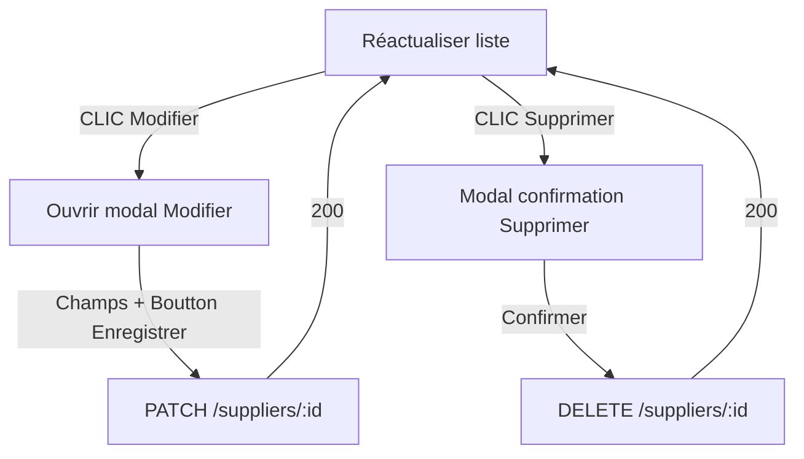

# Fournisseurs API (IDS)

> Module : `/suppliers` — Gestion des fournisseurs (civility, numéro, nom, contact, adresse, téléphone, email).
> Rôles : `superadmin` (tous les fournisseurs), `admin` (limités à leur point de vente).

## 1. Base URL

```text
http://localhost:3000/api/v1/suppliers
```

## 2. Enveloppe de réponse

Toute réponse suit le format uniforme (voir `docs/auth.md` §2) : `data` en succès, `error` en échec.

**Succès (200/201)** :
```json
{
  "data": { /* ApiSupplier */ },
  "message": "Fournisseur créé",
  "status": 201,
  "error": null,
  "signature": "IDS"
}
```

**Erreur** :
```json
{
  "data": null,
  "message": "Identifiants invalides",
  "status": 400,
  "error": { "code": "BAD_REQUEST" },
  "signature": "IDS"
}
```

## 3. Endpoints

### 3.1 GET `/suppliers` (admin, superadmin)

Liste paginée + filtres tri.

**Query params** :

| Param | Type | Défaut | Description |
|---|---|---|---|
| `page` | int ≥ 1 | 1 | page courante |
| `limit` | int 1–100 | 10 | éléments par page |
| `search` | string | — | ILIKE sur `numero`, `name`, `contact_name`, `email`, `telephone` |
| `sort_by` | enum | `created_at` | `numero`, `name`, `contact_name`, `email`, `created_at` |
| `sort_order` | enum | `DESC` | `ASC`, `DESC` |

**Réponse 200** (enveloppe avec `meta` rempli) :

```json
{
  "data": [ /* ApiSupplier[] */ ],
  "message": "Liste des fournisseurs",
  "status": 200,
  "meta": { "page": 1, "limit": 10, "total": 23 },
  "error": null,
  "signature": "IDS"
}
```

**Erreurs** : `401` (non authentifié), `403` (rôle requis : admin ou superadmin).

---

### 3.2 GET `/suppliers/:id` (admin, superadmin)

Fiche d'un fournisseur par identifiant.

**Réponse 200** :

```json
{
  "data": { /* ApiSupplier */ },
  "message": "Fournisseur récupéré",
  "status": 200,
  "error": null,
  "signature": "IDS"
}
```

**Erreurs** : `404` (introuvable), `403` (hors périmètre point de vente).

---

### 3.3 POST `/suppliers` (admin, superadmin)

Crée un fournisseur.

**Body** (`CreateSupplierPayload`) :

```json
{
  "numero": "FOU-001",
  "name": "ACME Distribution",
  "civility": "Mr",        // Mr / Mme / Mdlle
  "contact_name": "Jean Martin",
  "address": "12 Rue des Fleurs, Abidjan",
  "telephone": "+2250700000000",
  "email": "contact@acme.example",
  "point_of_sale_id": "<uuid>"   // optionnel, superadmin peut omettre
}
```

**Succès (201)** :
```json
{
  "data": { /* ApiSupplier créé */ },
  "message": "Fournisseur créé",
  "status": 201,
  "error": null,
  "signature": "IDS"
}
```

**Erreurs attendues** : `BAD_REQUEST` (champs invalides), `CONFLICT` (numéro duplicate), `FORBIDDEN` (rôle requis).

---

### 3.4 PATCH `/suppliers/:id` (admin, superadmin)

Met à jour une fiche.

**Body** (`UpdateSupplierPayload` = `Partial<CreateSupplierPayload>`) : seuls les champs fournis sont modifiés.

**Succès (200)** :
```json
{
  "data": { /* ApiSupplier mis à jour */ },
  "message": "Fournisseur mis à jour",
  "status": 200,
  "error": null,
  "signature": "IDS"
}
```

**Erreurs** : `CONFLICT` (numéro en conflit), `404` (introuvable), `403` (hors périmètre).

---

### 3.5 DELETE `/suppliers/:id` (admin, superadmin)

Supprime définitivement un fournisseur.

**Réponse 200** :
```json
{
  "data": { "supplier_id": "<uuid>" },
  "message": "Fournisseur supprimé",
  "status": 200,
  "error": null,
  "signature": "IDS"
}
```

**Erreurs** : `404` (introuvable), `403` (hors périmètre), `409` (encore des références).

---

## 4. Rôles et portée

| Rôle | Portée fournisseurs |
|---|---|
| `superadmin` | Tous les fournisseurs (multi-points de vente) |
| `admin` | Uniquement ceux rattachés à son `point_of_sale_id` |

L'API applique le scope automatique selon le rôle de l'utilisateur connecté.

## 5. Codes d'erreur fréquents

| Code | Signification | Front |
|---|---|---|
| `BAD_REQUEST` | Champs invalide ou duplicate | Afficher `error.details` ou `error.message` |
| `CONFLICT` | Numéro déjà utilisé | `"Ce numéro de fournisseur existe déjà."` |
| `FORBIDDEN` | Rôle insuffisant | Rediriger vers dashboard ou afficher toast |
| `404` | Fournisseur introuvable | `"Fournisseur introuvable"` |

## 6. Exemples de payloads

### Création

```json
{
  "numero": "FOU-001",
  "name": "Distributeur Général",
  "civility": "Mme",
  "contact_name": "Sophie Leblanc",
  "address": "45 Avenue Centrale, Dakar",
  "telephone": "+2250700001111",
  "email": "s.leblanc@distri.example"
}
```

### Mise à jour (PATCH) — seuls les champs fournis sont modifiés :

```json
{
  "telephone": "+2250700009999"
}
```

---

## 7. Flux type côté front



> **Note** : Toutes les actions destructives (suppression) et les modifications doivent passer par une modal de confirmation (`MConfirmDialog`) avant l'appel API.